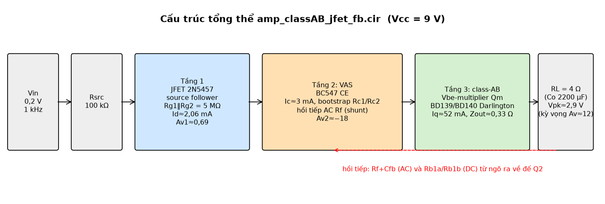
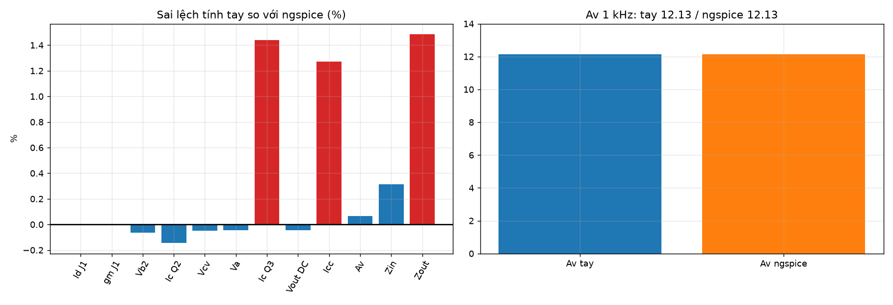
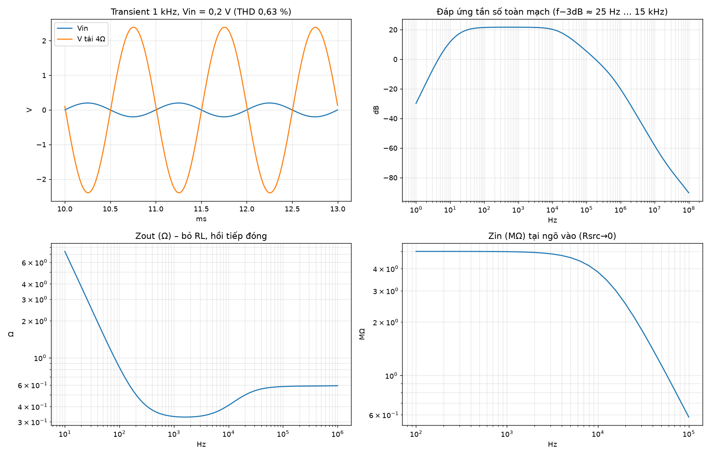
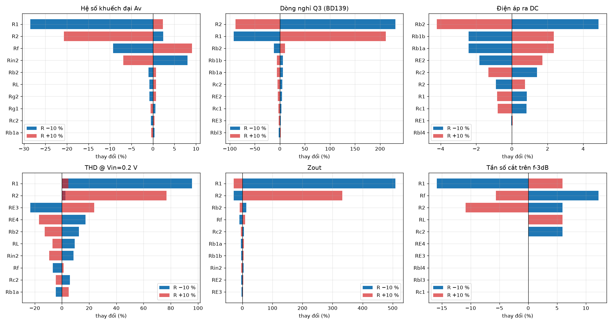
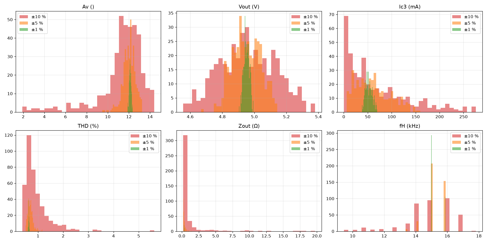
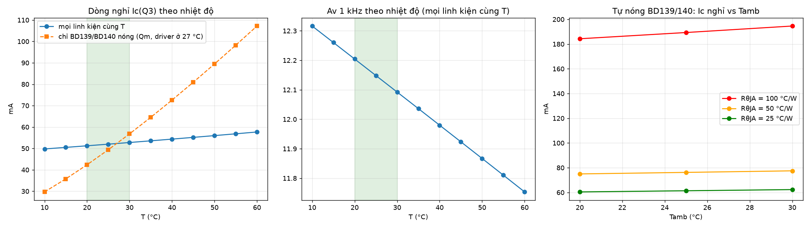

# Ampli âm tần 3 tầng: JFET → VAS → class-AB

Mạch gốc **không sửa**: [amp_classAB_jfet_fb.cir](amp_classAB_jfet_fb.cir) (chạy bằng ngspice-42; [run_and_plot.py](run_and_plot.py) quét Rf/THD). Mọi phân tích mới nằm trong [analysis/](analysis/). Nguồn 9 V, tải 4 Ω, môi trường dự kiến 20–30 °C.

---

## 1. Cấu trúc tổng thể



`Vin (0,2 V, 1 kHz) → Rsrc 100 kΩ → Tầng 1 → Tầng 2 → Tầng 3 → Co 2200 µF → RL 4 Ω`

| Khối | Linh kiện | Vai trò | Giá trị tại điểm làm việc |
|---|---|---|---|
| Nguồn + Rsrc | Vin, Rsrc = 100 kΩ | nguồn tín hiệu có nội trở | Zin tầng 1 = 5 MΩ nên suy hao chỉ 2 % |
| **Tầng 1** | JFET 2N5457, Rg1 = Rg2 = 10 MΩ (Vg = 4,5 V), Rs = 2,2 kΩ | source follower, trở kháng vào cao | Id = 2,06 mA, Vs = 4,52 V, gm = 3,06 mS, Av1 ≈ 0,69 |
| **Tầng 2 (VAS)** | Q2 BC547 (CE), RE1 + RE2, bootstrap Rc1/Rc2/Cboot, hồi tiếp AC Rf + Cfb, hồi tiếp DC Rb1a/Rb1b/Rb2 | khuếch đại điện áp, đặt gain bằng Rf/Rin2 | Ic = 3,0 mA, gm = 114 mS, Av2 ≈ −18 (vòng hồi tiếp T ≈ 10,5) |
| **Tầng 3** | Qm (bộ nhân Vbe), Darlington BC547+BD139 / BC557+BD140, RE3 = RE4 = 0,47 Ω | class-AB, cấp dòng cho tải 4 Ω | Ic nghỉ ≈ 52 mA, Vout DC = 4,95 V |
| Đầu ra | Co 2200 µF, RL 4 Ω | ghép tải | Vpk tối đa ≈ 2,8 V (≈ 1 W) |

**Kết quả kỳ vọng / đo (ngspice, 27 °C):** Av = 12,13 (21,7 dB), Zin = 4,98 MΩ, Zout = 0,33 Ω, THD = 0,63 % tại Vin = 0,2 V (ngõ ra 2,4 V đỉnh), f−3dB ≈ 25 Hz … 15 kHz, Icc = 59 mA.

---

## 2. Kiểm tra datasheet và xây dựng model SPICE

Chi tiết: [analysis/datasheet_check.md](analysis/datasheet_check.md). Script: [datasheet_check.py](analysis/datasheet_check.py).

Datasheet trong thư mục: 2N5457-D, BC550-D (họ BC546–550), BC556B-D (họ BC556–558), BD139-D, BD140-D. Netlist dùng `.model` BC547, BC557, BD139, BD140, 2N5457. So sánh bằng ngspice ở 20/25/30 °C:

| Linh kiện | Thông số | Datasheet | Model (25 °C) | KQ |
|---|---|---|---|---|
| BC547 | VBE(on) @2 mA / hFE | 0,58–0,70 V (typ 0,66) / 110–800 | 0,660 V / 309 | ✓ |
| BC547 | fT / Cob | 300 MHz / 3,5 pF | ≈363 MHz / 1,7 pF | ✓ / ⚠ Cob thấp 2× |
| BC557 | VBE(on) / hFE (B) | 0,55–0,70 V / 180–460 | 0,657 V / 320 | ✓ |
| BD139/140 | hFE @150 mA, VBE @0,5 A | 40–250, ≤ 1 V | 135, 0,79 V | ✓ |
| 2N5457 | IDSS, gm0 | 1–5 mA, 1–5 mS | 2,21 mA, 3,22 mS | ✓ |
| 2N5457 | VGS(off) | −0,5…−6 V | −1,37 V | ✓ (đầu thấp) |
| 2N5457 | VGS @ID = 100 µA | typ −2,5 V | −1,08 V | ⚠ khác nhiều |

Kết luận:
- Model BJT khớp datasheet về DC/hFE/Vbe. Datasheet chỉ cho họ linh kiện, không chỉ rõ nhóm hFE.
- Model 2N5457 là một con hợp lệ nhưng ở đầu pinch-off thấp. Giá trị VGS "typ" chỉ mang tính tham khảo, vì dải thực tế rất rộng.
- Bias DC của các tầng sau **không phụ thuộc con JFET** (có C12 chắn DC). Con JFET chỉ ảnh hưởng gm → **Av dao động 9,8–12,6** và THD (con IDSS ≈ 1 mA cho Vgs > 0, THD 3,7 %).
- Thử đưa cổng về 0 V (tự bias) cho kết quả kém hơn (Av 7–10, THD 1–3,7 %), nên giữ bias gốc (Vg = 4,5 V).
- Mức tải của linh kiện nằm trong giới hạn tuyệt đối, nhưng BD139/BD140 cần tản nhiệt (mục 4).

---

## 3. Tính tay và so sánh với SPICE

Lời giải từng bước (DC từng tầng, gm, Av, Zin, Zout): [analysis/hand_analysis.md](analysis/hand_analysis.md). Mã tính: [hand_calc.py](analysis/hand_calc.py). Ngspice đối chiếu: [check.cir](analysis/check.cir) (`.op`, `@dev[gm]`, tỉ số điện áp từng tầng).

Quy trình:
1. **DC:** JFET giải phương trình bậc 2 theo Id. VAS và tầng ra dùng Vbe = Vt·ln(Ic/IS) và Vab = Vbe_m(1 + R1/R2) = 4 Vbe. Đóng vòng hồi tiếp DC bằng cách chia đôi theo Ic2.
2. **Tín hiệu nhỏ:** gm = Ic/Vt, rπ = β/gm. Av = Av1 · Av2 · Av3 với Av2 = (A/Rin)/(Gtot − A/Rf) và A = −gm·Zx·G (có bootstrap).
3. **Zin** = Rg1‖Rg2. **Zout** = nghịch đảo tổng các dẫn nạp có hệ số hồi tiếp.

| Đại lượng | Tay | ngspice | Sai lệch |
|---|---|---|---|
| Id J1 | 2,057 mA | 2,057 | 0,0 % |
| gm J1 | 3,058 mS | 3,058 | 0,0 % |
| Ic Q2 / gm Q2 | 3,004 mA / 113,7 mS | 3,009 / 113,9 | −0,15 / −0,2 % |
| Vout DC | 4,949 V | 4,951 | −0,05 % |
| Ic nghỉ Q3 | 53,1 mA | 52,3 | +1,4 % |
| **Av 1 kHz** | 12,13 | 12,13 | 0,0 % |
| **Zin** | 5,0 MΩ | 4,98 MΩ | +0,3 % |
| **Zout** | 0,337 Ω | 0,332 Ω | +1,5 % |

Toàn bộ đại lượng lệch ≤ 2 % (lớn nhất: dòng nghỉ Q3, do xấp xỉ IKF/Early).



Hình minh họa từ mạch gốc (transient, đáp ứng tần số, Zin, Zout):



Ghi chú: Zout hở vòng ≈ 4,6 Ω (do bootstrap), nên Zout thấp 0,33 Ω nhờ hồi tiếp (hệ số giảm ≈ 13×).

---

## 4. Sai số điện trở và sai số nhiệt

### 4.1 Điện trở lệch ±10 %
Chi tiết: [analysis/phan_tich_dien_tro.md](analysis/phan_tich_dien_tro.md). Script: [sens_resistors.py](analysis/sens_resistors.py), dữ liệu [ket_qua_nhay/](analysis/ket_qua_nhay/).



| Điện trở | Ảnh hưởng chính khi ±10 % |
|---|---|
| **R1, R2** (bộ nhân Vbe) | dòng nghỉ −92 % … +230 %; R1 −10 % → class-B (Av −28 %, Zout +509 %) |
| **Rf, Rin2** | Av ≈ Rf/Rin2: ±9 % / ∓7 % |
| **Rb2, Rb1a/b** | điểm giữa Vout ±5 %; dòng nghỉ ±6–12 % |
| **RE3, RE4** | THD ∓17…23 % (cân bằng push-pull) |
| Còn lại | < 3 % |



Monte-Carlo 400 lần (yêu cầu tự đặt: Av 10–20, THD < 3 %, Ic nghỉ 20–100 mA, Vout 3,5–5,5 V, cắt ≥ 2 V):

| Dung sai | Av | Ic nghỉ Q3 | Đạt yêu cầu |
|---|---|---|---|
| ±1 % | 11,9–12,4 | 38–70 mA | 400/400 |
| ±5 % | 9,5–13,3 | 6–160 mA | 291/400 |
| ±10 % | 1,9–14,4 | 0,3–276 mA | 177/400 |

Khuyến nghị: R1/R2 (và Rf, Rin2) dùng 1 %, hoặc đổi R1 thành trimmer để chỉnh dòng nghỉ ≈ 50 mA. Các điện trở còn lại 5–10 % chấp nhận được.

### 4.2 Sai số nhiệt của transistor so với mô hình
Script: [temp_sweep.py](analysis/temp_sweep.py), [make_figures.py](analysis/make_figures.py).



| Tình huống | 20 → 30 °C | Nhận xét |
|---|---|---|
| Mọi linh kiện cùng nhiệt độ | Ic nghỉ 51,2 → 52,8 mA, Av 12,20 → 12,09, THD 0,637 → 0,633 % | thay đổi < 3 %, bỏ qua được |
| Chỉ BD139/BD140 nóng (Qm, driver ở nhiệt độ phòng) | Ic nghỉ ≈ 42 → 57 mA | ≈ +1,5 mA/°C: bộ nhân Vbe không bù nhiệt vì không gắn sát BD |
| Tự nóng, không tản nhiệt (RθJA = 100 °C/W) | Ic nghỉ ≈ 180–190 mA, Tj ≈ 92–106 °C, P ≈ 0,7–0,8 W mỗi BD | **vấn đề thật** |
| Tản nhiệt RθJA = 50 / 25 °C/W | 75–78 mA / 60–62 mA | chấp nhận được |

Nguồn sai số so với mô hình: model dùng IS(T), Vbe ≈ −2 mV/°C cho mỗi mối nối (bốn mối nối trong chuỗi Vab), hFE tăng theo nhiệt độ. Datasheet chỉ cho giá trị ở 25 °C, không có hệ số nhiệt riêng. Cần tản nhiệt cho BD139/BD140 (RθJA ≤ 50 °C/W) và nên gắn Qm sát thân BD139 để bù nhiệt.

---

## Chạy lại
```bash
cd analysis
python3 hand_calc.py            # tính tay + đối chiếu ngspice
python3 datasheet_check.py      # model vs datasheet (20/25/30 °C)
python3 temp_sweep.py           # nhiệt độ + tự nóng
python3 sens_resistors.py 400   # ±10 %, Monte-Carlo, góc xấu nhất
python3 make_figures.py         # hình trong analysis/figures/
```
Yêu cầu: ngspice-42, python3, numpy, matplotlib.

## Cấu trúc thư mục
```
amp_classAB_jfet_fb.cir   mạch gốc (không sửa)       run_and_plot.py   quét Rf/THD gốc
analysis/
  hand_calc.py, hand_analysis.md    tính tay, so SPICE
  datasheet_check.py/.md            model vs datasheet
  sens_resistors.py, sens_lib.py    ±10 %, Monte-Carlo    phan_tich_dien_tro.md
  temp_sweep.py, make_figures.py    nhiệt độ, hình
  check.cir, core.inc               netlist đối chiếu (bản sao mạch gốc, chỉ đổi lệnh .control)
  figures/, ket_qua_nhay/           hình và CSV
```
